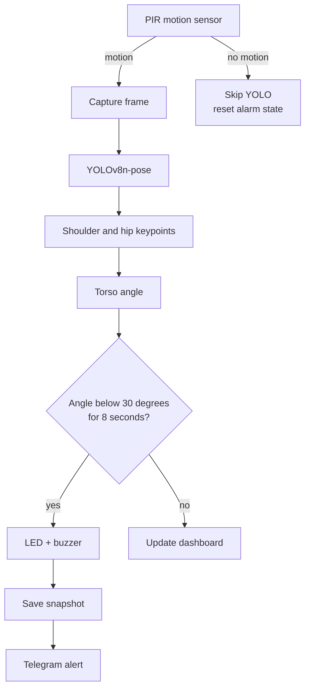

# SafeStep Watch

**A low-cost fall-detection monitor for elderly care, built on Raspberry Pi.**

SafeStep Watch uses a PIR motion sensor and YOLOv8 pose estimation to detect
when a person is lying on the floor. After an 8-second confirmation window, it
sounds a local alarm and sends a Telegram alert with a snapshot to a caregiver.
A Flask dashboard provides a live camera feed and system status over the local
network.


## Why I built this

Falls are a major risk for older adults, especially those living alone, and the
time between a fall and help arriving can make a serious difference. Commercial
fall-alert systems are often expensive or subscription-based. SafeStep Watch is
a low-cost proof of concept that runs entirely on a Raspberry Pi and uses an
affordable Raspberry Pi camera.

## Features

- **Motion-gated AI** - the PIR sensor triggers pose estimation only when
  movement is detected, reducing CPU load on the Pi.
- **Pose-based fall detection** - YOLOv8n-pose extracts shoulder and hip
  keypoints; the torso angle separates standing from lying.
- **False-alarm filter** - a fall is confirmed only if the lying posture
  persists for 8 seconds.
- **Local alarm** - LED and active buzzer provide an immediate alert in the room.
- **Caregiver alert** - Telegram message plus snapshot, with a 30-second
  cooldown to avoid spamming.
- **Live dashboard** - MJPEG video stream and JSON status endpoint on the LAN.
- **Privacy-conscious** - video never leaves the local network; only alert
  snapshots are sent to Telegram.

## How it works



1. The PIR sensor acts as a cheap first-stage trigger. If there is no motion,
   YOLO is skipped entirely and the alarm state is reset.
2. When motion is present, frames from the Camera Module 3 are passed to
   YOLOv8n-pose. Every second frame is processed to keep the Pi responsive.
3. The detector returns 17 COCO keypoints. SafeStep Watch uses the shoulders
   (indexes 5 and 6) and hips (11 and 12) to build a torso vector.
4. The angle between that vector and the horizontal is normalised to 0-90
   degrees. `0` means the torso is horizontal (lying), `90` means vertical
   (standing).
5. If the angle stays below `FALL_ANGLE_THRESHOLD` for `FALL_CONFIRM_SECS`, the
   fall is confirmed: the LED and buzzer turn on, a snapshot is saved, and a
   Telegram alert is sent.
6. The dashboard receives the annotated frames and live status through Flask.

## Hardware

| Component | Purpose |
|---|---|
| Raspberry Pi 4B or later | Runs detection and the web dashboard |
| Raspberry Pi Camera Module 3 | Video input |
| PIR motion sensor (e.g. HC-SR501) | First-stage motion trigger |
| LED + 220-330 ohm resistor | Local visual alarm |
| Active buzzer | Local audible alarm |
| Breadboard and jumper wires | Prototyping |
| 5 V power supply | Stable power for the Pi and peripherals |

### Wiring

| Component | Raspberry Pi pin | Notes |
|---|---|---|
| PIR VCC | 5 V (pin 2 or 4) | |
| PIR GND | GND | |
| PIR OUT | GPIO23 (pin 16) | |
| LED anode | GPIO27 (pin 13) | Through a 220-330 ohm resistor |
| LED cathode | GND | |
| Buzzer positive | GPIO22 (pin 15) | Active buzzer |
| Buzzer negative | GND | |

## Software setup

Target platform: Raspberry Pi 4B running Raspberry Pi OS (64-bit).

```bash
sudo apt update
sudo apt install -y python3-picamera2 python3-gpiozero

git clone https://github.com/ngaichunso/safestep-watch.git
cd safestep-watch

python3 -m venv --system-site-packages venv
source venv/bin/activate
pip install -r requirements.txt
```

`--system-site-packages` lets the virtual environment use the `picamera2` and
`gpiozero` packages installed by `apt`. The first `pip install` also downloads
PyTorch and is large, so give it time. If pip cannot find a compatible
PyTorch wheel for your Pi, install `torch` and `torchvision` first (see the
[Ultralytics Raspberry Pi guide](https://docs.ultralytics.com/guides/raspberry-pi/)).

`yolov8n-pose.pt` is downloaded automatically on first run if it is missing.

## Configuration

### Telegram alerts

1. Open Telegram and message **@BotFather**.
2. Send `/newbot`, follow the prompts, and copy the HTTP API token.
3. Start a chat with your new bot and send `/start`.
4. Get your chat ID from
   `https://api.telegram.org/bot<TOKEN>/getUpdates`, or message
   **@userinfobot**.
5. Set the values at the top of `app.py`:

```python
BOT_TOKEN = "123456789:your-token-here"
CHAT_ID = "123456789"
```

Keep the committed values empty and never commit a real bot token. If a token
is ever exposed, revoke it with **@BotFather** immediately. Telegram alerts are
skipped when credentials are not configured.

### Detection settings

| Setting | Default | Description |
|---|---|---|
| `FRAME_WIDTH` / `FRAME_HEIGHT` | `640 x 480` | Camera resolution |
| `MIN_CONF` | `0.4` | Minimum pose-detection confidence |
| `FALL_ANGLE_THRESHOLD` | `30` | Torso angle below which posture is "lying" |
| `FALL_CONFIRM_SECS` | `8` | Seconds the lying posture must persist |
| `ALERT_COOLDOWN_SECS` | `30` | Minimum seconds between repeated alerts |
| `FRAME_SKIP` | `2` | Process every Nth frame |

## Run

```bash
source venv/bin/activate
python app.py
```

Find the Pi's IP address with `hostname -I`, then open
`http://<pi-ip>:5000` from another device on the same network.

| Route | Purpose |
|---|---|
| `/` | Live dashboard |
| `/video_feed` | MJPEG camera stream |
| `/status` | JSON status (`system_status`, `pir_detected`, `last_angle`, `alarm_on`) |

The Flask development server is intended for a trusted local network. Do not
expose it directly to the internet.

## Project structure

```text
safestep_watch/
├── app.py                 # Detection loop, alarms, Telegram, Flask routes
├── templates/
│   └── index.html         # Live dashboard
├── captures/              # Alert snapshots (gitignored)
├── requirements.txt
├── yolov8n-pose.pt        # Auto-downloaded on first run (gitignored)
└── README.md
```

## Limitations

- Designed for a single person in view; multiple people are not tracked.
- Detection depends on camera placement, framing, and lighting.
- Lying down for other reasons (sleeping, exercise) can trigger the alarm.
- The dashboard has no authentication or HTTPS; use it on a trusted LAN only.
- Thresholds are fixed in code and not calibrated per room or person.
- Requires Raspberry Pi camera and GPIO hardware; there is no desktop/mock mode.
- This is a prototype, not a certified medical or safety device.

## Future work

- Add temporal context or an activity classifier to distinguish falls from
  resting on the floor.
- Support multiple people with tracking IDs.
- Add mobile push or SMS as a fallback when Telegram is unavailable.
- Publish status over MQTT / Home Assistant.
- Add dashboard authentication and HTTPS.
- Design a 3D-printed enclosure and a wearable version.

## Credits

- Built for **AST20707 Creative Electronics**, UOW College Hong Kong.
- Pose estimation: [Ultralytics YOLOv8](https://github.com/ultralytics/ultralytics).
- Built with [Flask](https://flask.palletsprojects.com/),
  [OpenCV](https://opencv.org/),
  [Picamera2](https://github.com/raspberrypi/picamera2), and
  [gpiozero](https://gpiozero.readthedocs.io/).

## License

Released under the MIT License. See [`LICENSE`](LICENSE).

---

**Safety note:** SafeStep Watch is a prototype. It is not a substitute
for a certified medical alert system or professional care. Do not rely on it as
the only fall-response mechanism for a vulnerable person.
